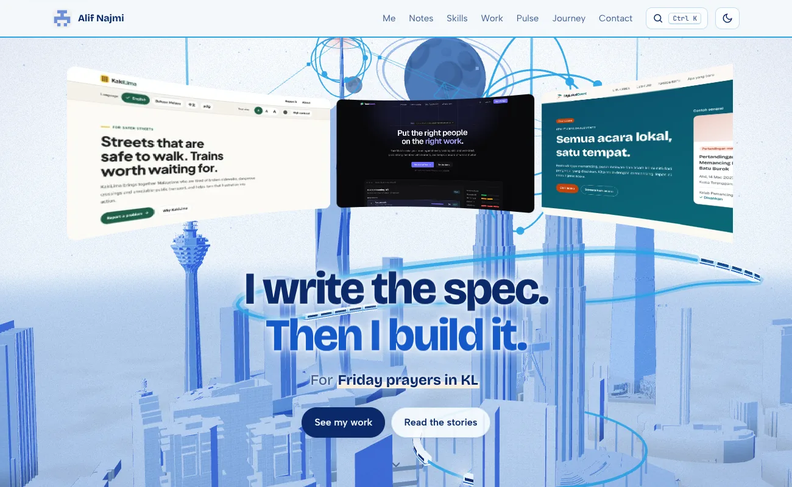
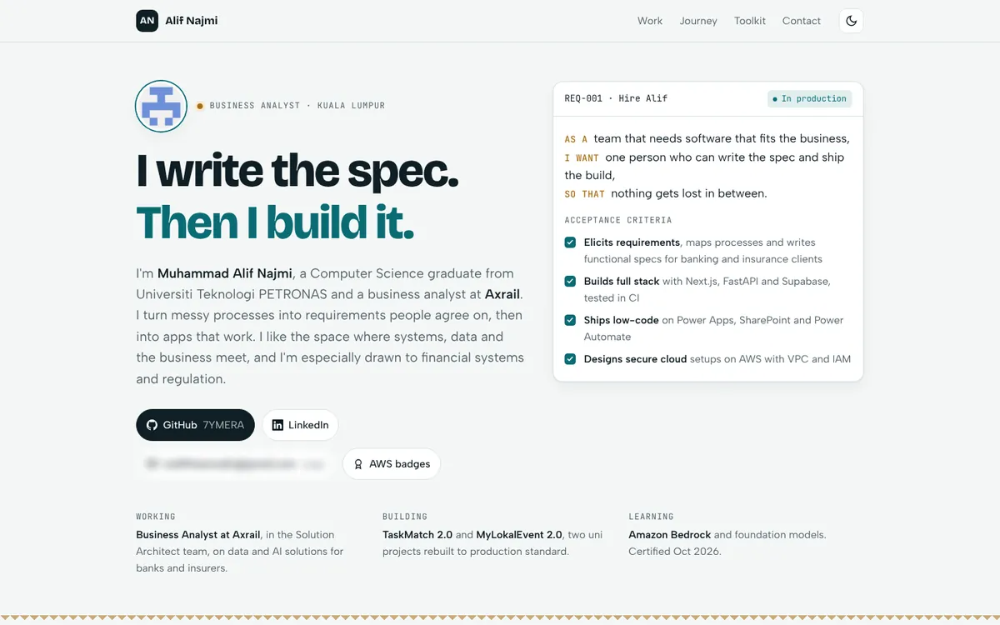
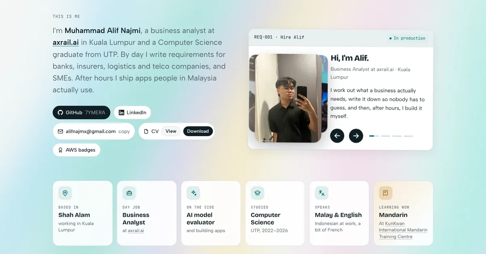
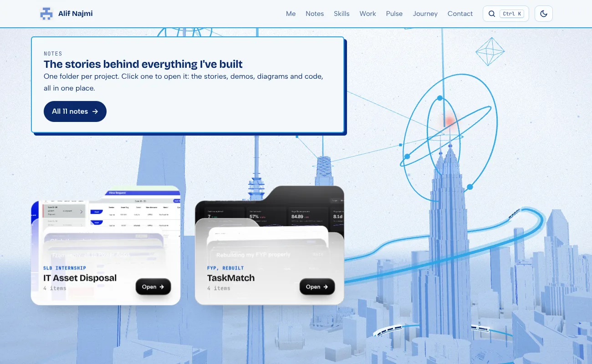
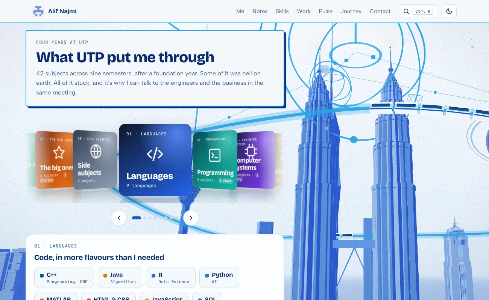
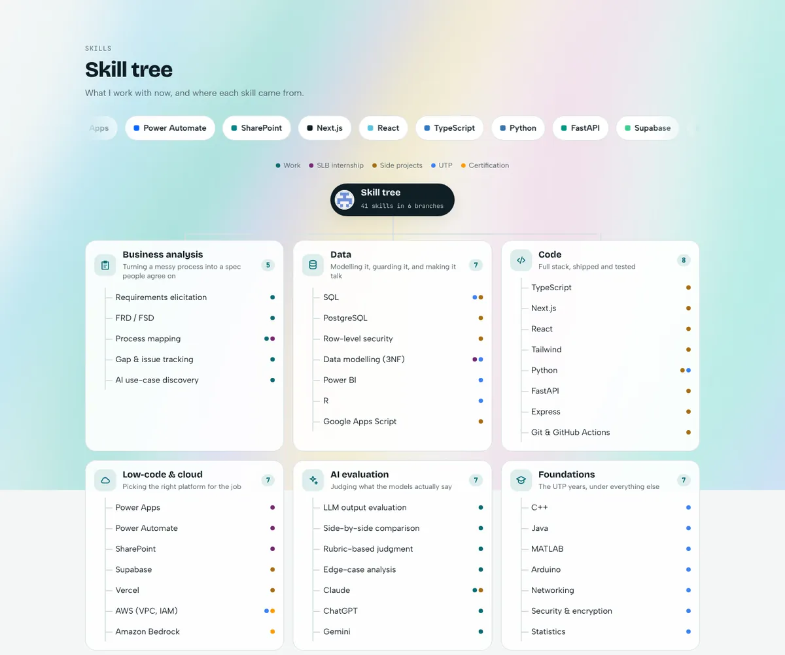
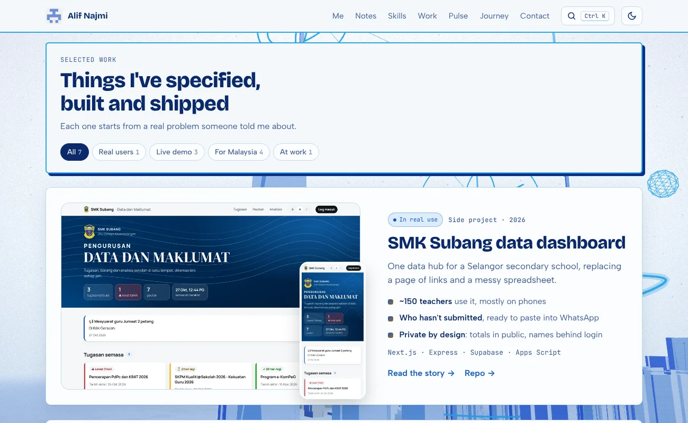
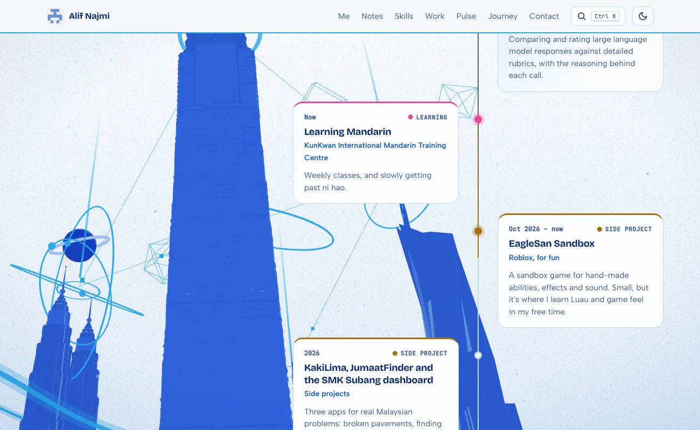
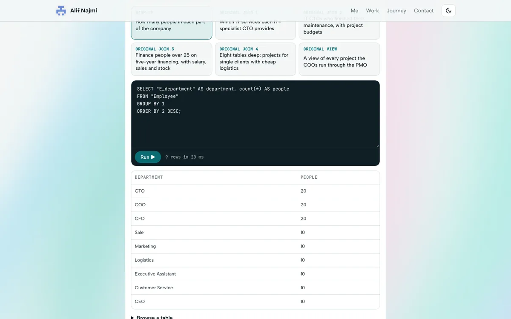

# 7ymera.github.io

Portfolio and notes of **Muhammad Alif Najmi**, business analyst at [axrail.ai](https://axrail.ai) and Computer Science graduate of Universiti Teknologi PETRONAS. Live at **<https://7ymera.github.io>**.

Plain HTML, CSS and JavaScript, served by GitHub Pages. There is no framework, no build step and nothing to install: edit a file, push to `main`, and the site updates in a minute or two.



---

## Contents

1. [How it started](#how-it-started)
2. [What's on the page](#whats-on-the-page)
3. [21st.dev components, ported to plain JS](#21stdev-components-ported-to-plain-js) ← start here if you're an agent borrowing code
4. [Rules that kept it fast](#rules-that-kept-it-fast)
5. [The notes](#the-notes)
6. [Repository layout](#repository-layout)
7. [Editing the site](#editing-the-site)
8. [Privacy rules](#privacy-rules)

---

## How it started

The first version (25 October 2026) was one static page: a manifesto, a "REQ-001 · Hire Alif" user-story card, three case studies and a timeline.



*The first version. The old personal email is blurred.*

The REQ-001 card, the "I write the spec. Then I build it." line and the teal-and-gold palette all survived. Almost everything else has been rebuilt since, in about 100 commits.

## What's on the page

The home page, top to bottom:

| Section | What it is | Built with |
|---|---|---|
| **Opening** (`#curtain`) | Name, two columns of convocation photos, and outer columns of *spec* (sketches, flowcharts, ERDs, requirement cards) and *built* (app screens). The spinning reel sits faintly behind. Scrolling parts the photos, fades the name, brings the reel forward and lands on "I write the spec. Then I build it." with two buttons. | `extras.js`, `curved-reel.js` |
| **This is me** (`#me`) | Intro and links, the REQ-001 card holding a five-slide carousel (slide 2, *Why hire me*, swaps the photo for a spec sheet and lists the acceptance criteria), and six fact tiles (based in, day job, side, studied, speaks, learning Mandarin). | `extras.js` |
| **Why I do this** (`#why`) | Three goals. | CSS only |
| **Notes** (`#notes`) | One glass folder per project. Opening one fans out the stories, demos, diagrams and repos. | `folders.js` |
| **What UTP put me through** (`#studied`) | A coverflow of eight subject groups. The centre group's subjects, with what I did in each, show underneath. | `coverflow.js` |
| **Skill tree** (`#toolkit`) | 41 skills in six branches, each dotted by where it came from (work, SLB, side projects, UTP, certification). | CSS + `extras.js` |
| **Selected work** (`#work`) | Six projects, with filters, screenshots and before/after sliders. | inline script in `index.html` |
| **Journey** (`#journey`) | Alternating cards on a centre line, coloured by kind, with a beam that fills as you scroll. | `extras.js` |
| **Contact** | Links and the CV. | |

| This is me | Notes as folders |
|---|---|
|  |  |
| **UTP coverflow** | **Skill tree** |
|  |  |
| **Selected work** | **Journey** |
|  |  |

Also on every page: a light/dark switch (light by default, choice remembered), **Ctrl+K** quick jump, a site-wide aurora background, and on phones a bottom dock that can be tucked away.

---

## 21st.dev components, ported to plain JS

Every interactive piece below started as a React + Tailwind component on [21st.dev](https://21st.dev). This site has no React, so each one was **rewritten as a small standalone script** that reads its data from a `data-*` attribute and builds its own markup. No dependencies, no build.

**To reuse one in another project:** copy the `.js` file, copy its block from `assets/site.css` (search for the heading comment named below), and add the markup from the *Usage* line. Each file starts with a comment explaining what it does and how to use it.

| # | 21st.dev component | Our version | File | Where it's used | Status |
|---|---|---|---|---|---|
| 1 | **Tilted Grid Hero** | A single row of screenshots running round the inside of a cylinder ("Spin" reel) | `assets/curved-reel.js` | Behind the opening | ✅ live |
| 2 | **Aurora Background** | A pre-rendered aurora *image* that slides with `transform` | CSS `.sky`, `.aurora` + `assets/aurora-*.webp` | Every page | ✅ live |
| 3 | **Tumble Deck Showcase** | A scroll-driven stack of cards that tip forward one by one | `assets/tumble-deck.js` | — | 💤 in the repo, not on the page |
| 4 | **Image Stream Hero** | One-sided corridor of images flowing towards you | `assets/image-stream.js` | Notes page header (`notes/`) | ✅ live |
| 5 | **Circular Testimonials** | Photo carousel with side photos tilted behind, text that blurs in word by word | `extras.js` (*This is me* block) | REQ-001 card | ✅ live |
| 6 | **Coverflow Carousel** | Album-style covers turned away on each side, detail panel below | `assets/coverflow.js` | UTP section | ✅ live |
| 7 | **Glassmorphism Folder Cards** | Glass folders that lean on hover and fan out their files when opened | `assets/folders.js` | Notes section | ✅ live |
| 8 | Number ticker, Timeline beam, Border spotlight, Dock, Marquee | Small effects | `extras.js` | Around the page | ✅ live |

### 1 · Tilted Grid Hero → curved reel (`curved-reel.js`)

```html
<div class="reel" data-reel='["a.webp","b.webp"]' data-tile="54" data-speed="3.5" data-curve="70" data-slices="8"></div>
```

- **How it works:** each tile is cut into vertical strips (`data-slices`, default 16), each strip rotated to be one facet of the cylinder. The *tile* is what animates (one CSS `@keyframes` per reel), so its strips can't drift apart. A tile swaps to its next image on `animationiteration`, while it's out of sight, after `decode()` so it never flashes empty.
- **Changed from the original:** no React state per frame. Geometry is computed once per resize with `ResizeObserver`, and everything else is CSS animation. Press and hold to pause (`.held`).
- **Lessons:**
  - Fewer strips means fewer 3D layers: the opening uses `data-slices="8"`.
  - Never put a 3D scene inside a `mask-image` or a rounded `clip-path`. That forces a full repaint every frame: we measured 21 fps vs 60.
  - Never fade it with background-coloured overlays if the page behind it moves. They stop matching and look like flicker.

### 2 · Aurora Background → a picture that slides (`.sky`)

- The original animates big blurred, blended gradients live. That cost 12 fps on the hero.
- Here it's **rendered once into a WebP** (`aurora-light-2.webp`, `aurora-dark.webp`) and a single fixed `.sky` layer slides it with `translate3d` over 90 s. The GPU just moves a finished image.
- Light and dark images are swapped through CSS variables. If you change the image, give it a new filename so browsers drop the cached one.

### 3 · Tumble Deck Showcase → `tumble-deck.js`

```html
<section class="deck" data-aspect="1.6" data-deck='[{"src":"a.webp","alt":"…","title":"…","sub":"…"}]'>
  <div class="deck-stage"><div class="deck-head">…</div><div class="deck-scene"></div>
  <div class="deck-cap"><span class="deck-count"></span><span class="deck-title"></span><span class="deck-sub"></span></div></div>
</section>
```

- **Driven by page scroll, not the wheel.** The original hijacks the wheel. Here the section is tall, the stage is `position: sticky`, and progress is how far you've scrolled through it, eased with exponential smoothing in `requestAnimationFrame`. The page never gets stuck.
- Uses the original's `fallAngle` / `deckAdvance` / `cardPose` maths. Click or the arrow keys jump to the next card.
- It was on the home page with a Tumble/Spin switch until the November revamp moved the reel into the opening.

### 4 · Image Stream Hero → `image-stream.js`

```html
<div class="stream" data-stream='["a.webp","b.webp"]' data-speed="28"></div>
```

- **One wall instead of two.** Panels ride a single wall rotated `-78deg` in a `perspective` container and animate with one shared keyframe at staggered negative delays.
- Only `transform` and `opacity` animate. Paused off-screen with `IntersectionObserver`.

### 5 · Circular Testimonials → the *This is me* carousel (`extras.js`)

- Three positions (`.on`, `.prev`, `.next`) switched by class. CSS transitions do the swing.
- Each quote is split into word `<span>`s that blur in one after another.
- **Timing:**
  - It moves on every 5 s. The timer is the progress bar's CSS animation, and `animationend` advances it.
  - Any manual move (arrows, dots, swipe, keys, clicking a side photo) pauses it for 20 s.
  - It also pauses off-screen.
- **Bug to avoid:** don't pause on `focus`. A clicked arrow keeps focus and the carousel never resumes.

### 6 · Coverflow Carousel → `coverflow.js`

```html
<div class="cf" data-cf data-start="0">
  <div class="cf-stage"><div class="cf-item">…</div>…</div>
  <div class="cf-nav"><button class="cf-btn" data-dir="-1"></button><div class="cf-dots"></div><button class="cf-btn" data-dir="1"></button></div>
  <div class="cf-details"><div class="cf-detail">…</div>…</div>
</div>
```

- **Loops:** the offset is wrapped, so there are always covers on both sides. A cover jumping from one end to the other skips its transition.
- **Spacing uses the covers' real width.** Wide covers spaced as if square overlap the centre.
- Arrows, dots, swipe, keys and clicking a side cover all work. The reflection is `-webkit-box-reflect`.
- **Covers must match the frame's shape.** Portrait images in a landscape frame crop badly. We make dedicated covers: a 2×2 photo grid, or a diagram fitted whole with margins.

### 7 · Glassmorphism Folder Cards → `folders.js`

```html
<div class="fd-grid" data-folders='[{"label":"TaskMatch","kicker":"FYP, rebuilt","cover":"cover.webp",
  "files":[{"name":"Live demo","meta":"No login","href":"https://…","img":"shot.webp"}]}]'></div>
```

- Same geometry as the original (`clip-path: path()` shapes drawn at 340 × 272 and scaled to the real width). Same states: rest, lean on hover, open and fan.
- **Fake glass.** The original frosts with `backdrop-filter`. Over a moving background that re-blurs every frame, so the front panel is a translucent milky gradient plus a cursor-following highlight instead.
- **Real screenshots instead of generated art.** The original paints its own noise-art into a canvas. We use project screenshots for the back panel and the files.
- The files are real `<a>` links, out of the tab order while closed. Escape or a click outside closes it, and only one folder is open at a time.

### 8 · Small effects (`extras.js`)

- **Number ticker:** counts up once when it scrolls into view.
- **Timeline beam:** a gold line fills down the journey as you scroll and lights each dot.
- **Border spotlight:** a card edge glows under the cursor via `--mx` / `--my`.
- **Dock:** a phone-only bottom bar that highlights the section you're in and can be tucked away (remembered in `localStorage`).
- **Marquee:** the scrolling tool names above the skill tree.

### Our own pieces (not from 21st.dev)

- **The opening:** a sticky stage whose progress drives the photo columns, name, reel and headline in three acts, all with `transform` and `opacity`.
- **Spec / built columns** beside the photos.
- **Before/after sliders** (a range input over two images clipped with `--pos`).
- **The skill tree.**
- **SQL playgrounds** (`db-playground.js`): sql.js (SQLite in WebAssembly) loads a database file only when the playground nears the screen, then runs the original coursework queries in the browser.

---

## Rules that kept it fast

Measured with Playwright and Chrome DevTools' CPU throttling (×4), scrolling the whole page in 6 seconds. Target: 60 fps on a phone, 50+ on desktop.

1. **Animate only `transform` and `opacity`**, and write them straight to the element that moves. Changing a CSS variable on a big subtree restyles the whole subtree.
2. **No live blur over moving things.** No `backdrop-filter` over the aurora (the header and dock are near-solid instead), and no animated `filter: blur`.
3. **No `mask-image` and no rounded `clip-path` on anything containing 3D.** A plain rectangle clip is cheap; rounded corners and masks are not.
4. **Pre-render what you can:** the aurora is an image, and diagrams are SVG drawn once.
5. **Pause what's off-screen** with `IntersectionObserver` (`.offscreen` class → `animation-play-state: paused`).
6. **Respect `prefers-reduced-motion`.** Every animated piece has a still fallback.
7. **Bump the cache key.** Stylesheets and scripts load as `file.css?v=YYYYMMDDx`. Change it on every CSS/JS change, or visitors keep the old file. When replacing an image, use a new filename.

## The notes

Long-form write-ups in `notes/`, linked from the Notes folders and listed at [`/notes/`](https://7ymera.github.io/notes/):

| Note | About |
|---|---|
| `slb-power-apps.html` | The SLB internship app, from Excel and email to Power Apps |
| `slb-design.html` | Its flowcharts, ERDs and the final data model, drawn as SVG |
| `slb-screens.html` | A 26-screen click-through of the app |
| `taskmatch-v2.html` | Rebuilding the final year project properly |
| `mylokalevent-v2.html` | From coursework to something people could trust |
| `smk-dashboard.html` | A school data dashboard ~150 teachers use |
| `kakilima.html` | Accessible first, in four languages |
| `jumaatfinder.html` | Finding Friday prayers from official data |
| `aws-two-departments.html` | The UTP AWS assignment, where my AWS started |
| `database.html` | A company database in 49 tables, with a live SQL playground |
| `jom-al-quran.html` | A 56-table tuition business database, with a live SQL playground |
| `convocation-2026.html` | Graduation day |



The note pages share one template. Their themed SVG diagrams (flowcharts, sequence diagrams, ERDs) are inline, so they follow light and dark mode.

## Repository layout

```
index.html               the home page (sections listed above)
notes/                   the notes, plus notes/index.html
assets/
  site.css               all styles, one file, with a comment heading per component
  extras.js              opening, carousel, ticker, beam, dock, skill tree
  curved-reel.js         21st.dev Tilted Grid Hero port
  tumble-deck.js         21st.dev Tumble Deck Showcase port (not on the page now)
  image-stream.js        21st.dev Image Stream Hero port
  coverflow.js           21st.dev Coverflow Carousel port
  folders.js             21st.dev Glassmorphism Folder Cards port
  db-playground.js       sql.js playground for the database notes
  db/                    the two SQLite databases (personal data replaced with fake values)
  me/                    photos
  notes/                 note images, covers, diagrams
  slb-screens/           the SLB click-through
  Muhammad-Alif-Najmi-CV.pdf
docs/screens/            screenshots used in this README
```

## Editing the site

- **Text:** edit `index.html` or the note pages directly.
- **Styles:** `assets/site.css`. Newer rules sit lower in the file and win over older ones.
- **After changing any CSS or JS,** bump the `?v=` key in every page, for example `sed -i 's/?v=20261107k/?v=20261107l/g' index.html notes/*.html`.
- **Theme colours** are CSS variables on `:root`, redefined for dark mode under both `prefers-color-scheme: dark` and `[data-theme="dark"]`.
- **Check before pushing:** load the page at 1300 px and 390 px wide, make sure nothing scrolls sideways, and watch the console for errors.

## Privacy rules

- No client names or project details from work at axrail.ai.
- Colleagues' names, emails and phone numbers are blurred in SLB screenshots. No internal SharePoint addresses.
- Photo metadata (EXIF, GPS) is stripped. Images are re-saved as WebP.
- The coursework databases have every name, IC number, email and phone number replaced with a consistent fake value, so the joins still work.
- Classmates' names and student IDs from group work are never published.
