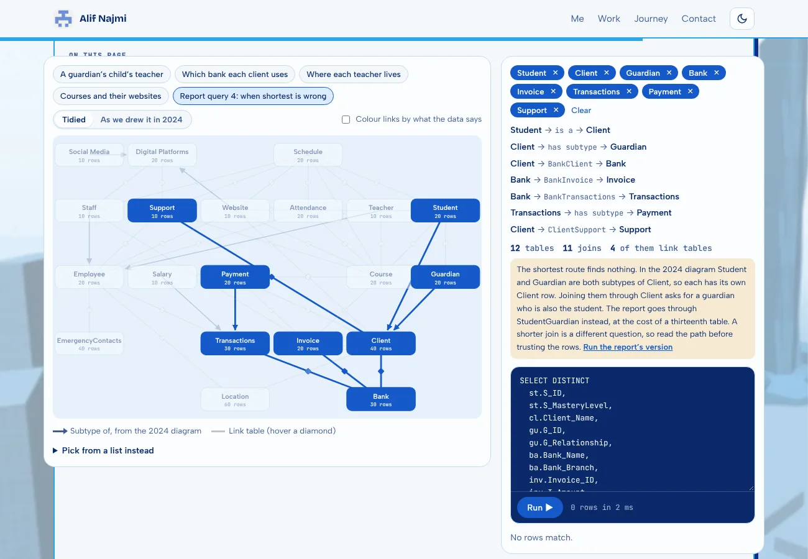
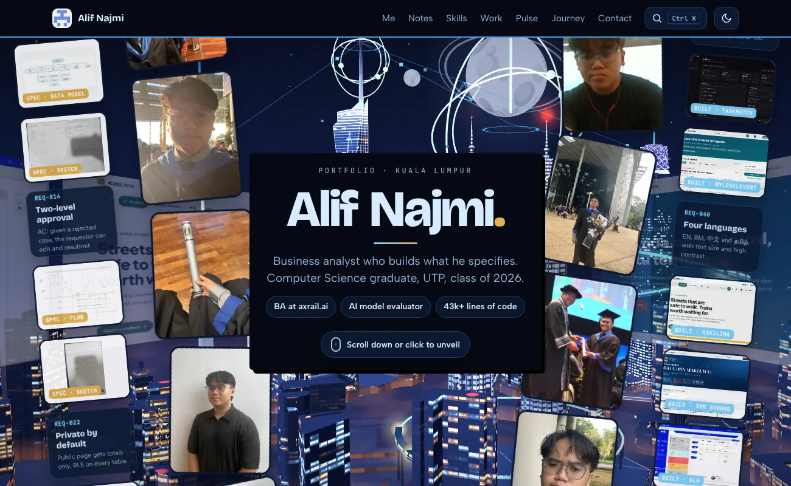
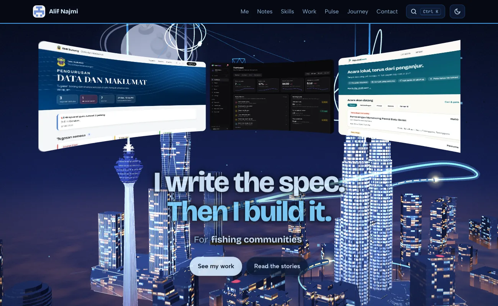
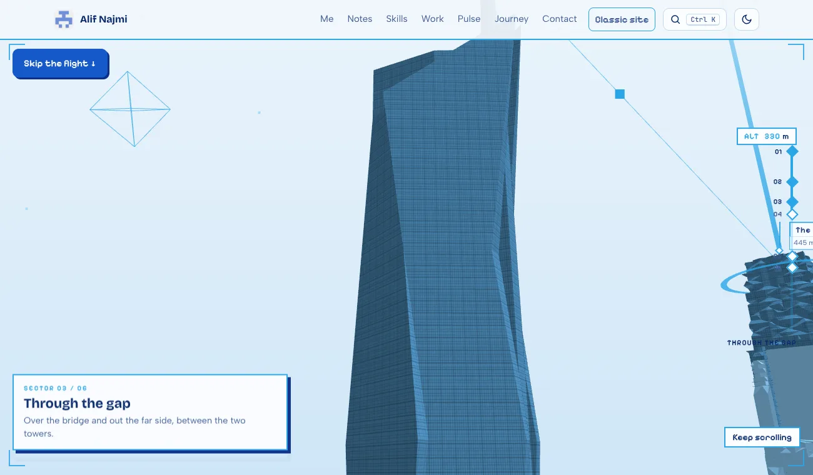
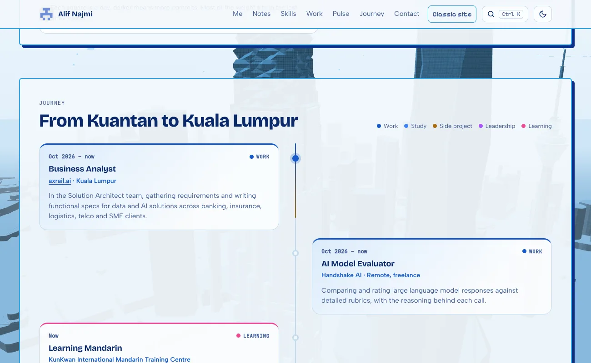
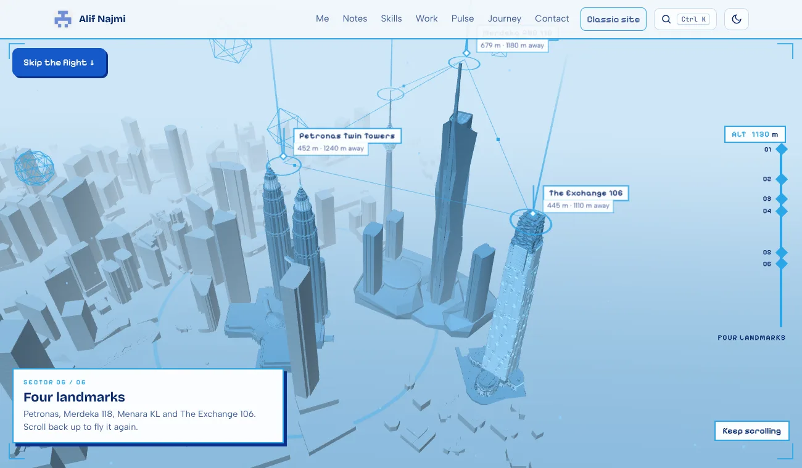

# 7ymera.github.io

Portfolio and notes of **Muhammad Alif Najmi**, business analyst at [axrail.ai](https://axrail.ai) and Computer Science graduate of Universiti Teknologi PETRONAS. Live at **<https://7ymera.github.io>**.

Plain HTML, CSS and JavaScript, served by GitHub Pages. There is no framework, no build step and nothing to install: edit a file, push to `main`, and the site updates in a minute or two.

> **AI agents:** start with [`CLAUDE.md`](CLAUDE.md) and the latest entry in [`docs/claude-log.md`](docs/claude-log.md), then read only the README section you need.


---

## Contents

1. [How it started](#how-it-started)
2. [Version history](#version-history)
3. [What's on the page](#whats-on-the-page)
4. [21st.dev components, ported to plain JS](#21stdev-components-ported-to-plain-js) ← start here if you're an agent borrowing code
5. [The 3D city and the flight](#the-3d-city-and-the-flight)
6. [Rules that kept it fast](#rules-that-kept-it-fast)
7. [The notes](#the-notes)
8. [Repository layout](#repository-layout)
9. [Editing the site](#editing-the-site)
10. [Privacy rules](#privacy-rules)

---

## How it started

The first version (25 October 2026) was one static page: a manifesto, a "REQ-001 · Hire Alif" user-story card, three case studies and a timeline.


*The first version. The old personal email is blurred.*

The REQ-001 card, the "I write the spec. Then I build it." line and the teal-and-gold palette all survived. Almost everything else has been rebuilt since, in about 100 commits.

## Version history

**Current version: 2.6.** Numbering: the first number changes when the site changes character (1.0 was a static page, 2.0 became the 3D city). The second number goes up for a major overhaul or a notable new feature. Small fixes and tweaks do not get a number; they live in [`docs/claude-log.md`](docs/claude-log.md). Dates come from the work log. Commit ids are on `main`: `git show <id>`.

| Version | Date | What changed | Commit |
|---|---|---|---|
| **1.0** | 25 Oct 2026 | The first page: a manifesto, the REQ-001 "Hire Alif" card, three case studies and a timeline. Teal and gold. | (before this history) |
| **1.1** | 6 Nov | Light mode by default, the curtain opening, a colourful aurora, a photo carousel in *This is me*, the first project notes. | `c0784a1` |
| **1.2** | 6 Nov | *What UTP put me through* (42 subjects), the skill tree, coverflow carousels, the image stream, the spin reel. | `2d44530`, `3e55370` |
| **1.3** | 7 Nov | The glass project folders, live SQL playgrounds in two database notes, the two-sided REQ-001 card, the outer photo columns, the README. | `62d5f10` |
| **1.4** | 8 Nov | The Pulse status report with a live activity feed, and the handoff files (`CLAUDE.md`, the work log, the smoke test). | `85c014f` |
| **1.5** | 9 Nov | The first low-poly Kuala Lumpur skyline, as a separate `/v2/` preview with floating windows. | `88e63a8` |
| **1.6** | 10 Nov | A real 3D scene: scroll-driven camera, the real Petronas Towers, Merdeka 118, Menara KL and The Exchange 106, an OpenStreetMap city with windows lit at night. | `a77da07` to `6818a90` |
| **1.7** | 10 Nov | The whole home page merged into the 3D version, with a calm one-way flight and a sci-fi HUD. | `c5ca5b5`, `a1478db` |
| **2.0** | 10 Nov | **One site.** The 3D city became the home page at `/`; no more `/v2/`. The flat-aurora site is kept at commit `f3b9f08`. | `76230a4` |
| **2.1** | 10 Nov | The notes pages re-skinned to match, `/flight/` (the flight on its own, with a viewer panel), a scroll buffer after the opening where the city turns. | `2759adb`, `ea000cd` |
| **2.2** | 11 Nov | A camera shot for every section (a director): the UTP shots follow the coverflow, the skill tree splits round Merdeka 118. The KLCC district becomes the map. | `183c59e`, `8e7c9aa`, `209e535` |
| **2.3** | 11 Nov | No panels behind any block, so the city shows through everywhere, phones included. The content goes behind the top bar. | `0b93ad8`, `813d708` |
| **2.4** | 12 Nov | More love for Merdeka 118 (a lead-in and a flight that climbs it), the flight reworked (no wall clips, no whips, captions in step), a new finale: a horizontal skyline, or a full zoom-out on phones. | `d6e08db`, `a37d9c2`, `e4acb09` |
| **2.5** | 12 Nov | **The sci-fi layer:** stars, a ringed moon with a moon of its own, gyroscope rings round the Petronas and Merdeka crowns, and a dragon of light looping the skyline. | `1be0d1f` |
| **2.6** | 12 Nov | **The drone flight.** A new route: a spiral climb up the Petronas Towers, Menara KL and Merdeka 118, a barrel roll through the skybridge gap, a spiral dive down The Exchange 106; a zoom out then zoom in from Journey; a pilot cockpit overlay (compass, artificial horizon, speed, REC timer); and a finale that holds the skyline much longer. | `HASH` |

Tried and dropped along the way (still in git history): a clothes-rail project gallery (`5c68a02`), a ring and then a conveyor of floating screens, a Masjid Negara you could fly into, and a 5 second phone loading screen. The longer story of the 3D city is in *The 3D city and the flight* below.

---

## What's on the page

The home page, top to bottom:

| Section | What it is | Built with |
|---|---|---|
| **Opening** (`#curtain`) | Name, two columns of convocation photos, and outer columns of *spec* (sketches, flowcharts, ERDs, requirement cards) and *built* (app screens). The spinning reel sits faintly behind. Scrolling parts the photos, fades the name, brings the reel forward and lands on "I write the spec. Then I build it." with two buttons. | `extras.js`, `curved-reel.js` |
| **This is me** (`#me`) | Intro and links, the REQ-001 card holding a five-slide carousel (slide 2, *Why hire me*, swaps the photo for a spec sheet and lists the acceptance criteria), and six fact tiles (based in, day job, side, studied, speaks, learning Mandarin). | `extras.js` |
| **Why I do this** (`#why`) | Three goals. | CSS only |
| **Notes** (`#notes`) | One glass folder per project. Opening one fans out the stories, demos, diagrams and repos. | `folders.js` |
| **What UTP put me through** (`#studied`) | A coverflow of eight subject groups. The centre group's subjects, with what I did in each, show underneath. | `coverflow.js` |
| **Skill tree** (`#toolkit`) | 41 skills in six branches, each dotted by where it came from (work, SLB, side projects, UTP, certification). | CSS + `extras.js` |
| **Selected work** (`#work`) | Seven projects, with filters, screenshots and before/after sliders. | inline script in `index.html` |
| **Pulse** (`#pulse`) | Status report: stat tiles, project board, 17-week commit map and a recent-activity feed. The feed tries GitHub's public events API and falls back to the snapshot. | `assets/pulse.js`, `assets/pulse-data.json` |
| **Journey** (`#journey`) | Alternating cards on a centre line, coloured by kind, with a beam that fills as you scroll. | `extras.js` |
| **Contact** | Links and the CV. | |

| This is me | Notes as folders |
|---|---|
|  |  |
| **UTP coverflow** | **Skill tree** |
|  |  |
| **Selected work** | **Journey** |
|  |  |

Also on every page: a light/dark switch (light by default, choice remembered), **Ctrl+K** quick jump, the city as the backdrop (live 3D on the home page, a still picture on the notes pages), and on phones a bottom dock that can be tucked away.

---

## 21st.dev components, ported to plain JS

Every interactive piece below started as a React + Tailwind component on [21st.dev](https://21st.dev). This site has no React, so each one was **rewritten as a small standalone script** that reads its data from a `data-*` attribute and builds its own markup. No dependencies, no build.

**To reuse one in another project:** copy the `.js` file, copy its block from `assets/site.css` (search for the heading comment named below), and add the markup from the *Usage* line. Each file starts with a comment explaining what it does and how to use it.

| # | 21st.dev component | Our version | File | Where it's used | Status |
|---|---|---|---|---|---|
| 1 | **Tilted Grid Hero** | A single row of screenshots running round the inside of a cylinder ("Spin" reel) | `assets/curved-reel.js` | Behind the opening | ✅ live |
| 2 | **Aurora Background** | A pre-rendered aurora *image* that slides with `transform` | CSS `.sky`, `.aurora` + `assets/aurora-*.webp` | Nothing now: the home page and the notes pages both use the city (the CSS is kept in `site.css`) | 💤 unused |
| 3 | **Tumble Deck Showcase** | A scroll-driven stack of cards that tip forward one by one | `assets/tumble-deck.js` | — | 💤 in the repo, not on the page |
| 4 | **Image Stream Hero** | One-sided corridor of images flowing towards you | `assets/image-stream.js` | Notes page header (`notes/`) | ✅ live |
| 5 | **Circular Testimonials** | Photo carousel with side photos tilted behind, text that blurs in word by word | `extras.js` (*This is me* block) | REQ-001 card | ✅ live |
| 6 | **Coverflow Carousel** | Album-style covers turned away on each side, detail panel below | `assets/coverflow.js` | UTP section | ✅ live |
| 7 | **Glassmorphism Folder Cards** | Glass folders that lean on hover and fan out their files when opened | `assets/folders.js` | Notes section | ✅ live |
| 8 | Number ticker, Timeline beam, Border spotlight, Dock, Marquee | Small effects | `extras.js` | Around the page | ✅ live |

### 1 · Tilted Grid Hero → curved reel (`curved-reel.js`)

```html
<div class="reel" data-reel='["a.webp","b.webp"]' data-tile="54" data-speed="3.5" data-curve="70" data-slices="8"></div>
```

- **How it works:** each tile is cut into vertical strips (`data-slices`, default 16), each strip rotated to be one facet of the cylinder. The *tile* is what animates (one CSS `@keyframes` per reel), so its strips can't drift apart. A tile swaps to its next image on `animationiteration`, while it's out of sight, after `decode()` so it never flashes empty.
- **Changed from the original:** no React state per frame. Geometry is computed once per resize with `ResizeObserver`, and everything else is CSS animation. Press and hold to pause (`.held`).
- **Lessons:**
  - Fewer strips means fewer 3D layers: the opening uses `data-slices="8"`.
  - Never put a 3D scene inside a `mask-image` or a rounded `clip-path`. That forces a full repaint every frame: we measured 21 fps vs 60.
  - Never fade it with background-coloured overlays if the page behind it moves. They stop matching and look like flicker.

### 2 · Aurora Background → a picture that slides (`.sky`)

- The original animates big blurred, blended gradients live. That cost 12 fps on the hero.
- Here it's **rendered once into a WebP** (`aurora-light-2.webp`, `aurora-dark.webp`) and a single fixed `.sky` layer slides it with `translate3d` over 90 s. The GPU just moves a finished image.
- Light and dark images are swapped through CSS variables. If you change the image, give it a new filename so browsers drop the cached one.

### 3 · Tumble Deck Showcase → `tumble-deck.js`

```html
<section class="deck" data-aspect="1.6" data-deck='[{"src":"a.webp","alt":"…","title":"…","sub":"…"}]'>
  <div class="deck-stage"><div class="deck-head">…</div><div class="deck-scene"></div>
  <div class="deck-cap"><span class="deck-count"></span><span class="deck-title"></span><span class="deck-sub"></span></div></div>
</section>
```

- **Driven by page scroll, not the wheel.** The original hijacks the wheel. Here the section is tall, the stage is `position: sticky`, and progress is how far you've scrolled through it, eased with exponential smoothing in `requestAnimationFrame`. The page never gets stuck.
- Uses the original's `fallAngle` / `deckAdvance` / `cardPose` maths. Click or the arrow keys jump to the next card.
- It was on the home page with a Tumble/Spin switch until the November revamp moved the reel into the opening.

### 4 · Image Stream Hero → `image-stream.js`

```html
<div class="stream" data-stream='["a.webp","b.webp"]' data-speed="28"></div>
```

- **One wall instead of two.** Panels ride a single wall rotated `-78deg` in a `perspective` container and animate with one shared keyframe at staggered negative delays.
- Only `transform` and `opacity` animate. Paused off-screen with `IntersectionObserver`.

### 5 · Circular Testimonials → the *This is me* carousel (`extras.js`)

- Three positions (`.on`, `.prev`, `.next`) switched by class. CSS transitions do the swing.
- Each quote is split into word `<span>`s that blur in one after another.
- **Timing:**
  - It moves on every 5 s. The timer is the progress bar's CSS animation, and `animationend` advances it.
  - Any manual move (arrows, dots, swipe, keys, clicking a side photo) pauses it for 20 s.
  - It also pauses off-screen.
- **Bug to avoid:** don't pause on `focus`. A clicked arrow keeps focus and the carousel never resumes.

### 6 · Coverflow Carousel → `coverflow.js`

```html
<div class="cf" data-cf data-start="0">
  <div class="cf-stage"><div class="cf-item">…</div>…</div>
  <div class="cf-nav"><button class="cf-btn" data-dir="-1"></button><div class="cf-dots"></div><button class="cf-btn" data-dir="1"></button></div>
  <div class="cf-details"><div class="cf-detail">…</div>…</div>
</div>
```

- **Loops:** the offset is wrapped, so there are always covers on both sides. A cover jumping from one end to the other skips its transition.
- **Spacing uses the covers' real width.** Wide covers spaced as if square overlap the centre.
- Arrows, dots, swipe, keys and clicking a side cover all work. The reflection is `-webkit-box-reflect`.
- **Covers must match the frame's shape.** Portrait images in a landscape frame crop badly. We make dedicated covers: a 2×2 photo grid, or a diagram fitted whole with margins.

### 7 · Glassmorphism Folder Cards → `folders.js`

```html
<div class="fd-grid" data-folders='[{"label":"TaskMatch","kicker":"FYP, rebuilt","cover":"cover.webp",
  "files":[{"name":"Live demo","meta":"No login","href":"https://…","img":"shot.webp"}]}]'></div>
```

- Same geometry as the original (`clip-path: path()` shapes drawn at 340 × 272 and scaled to the real width). Same states: rest, lean on hover, open and fan.
- **Fake glass.** The original frosts with `backdrop-filter`. Over a moving background that re-blurs every frame, so the front panel is a translucent milky gradient plus a cursor-following highlight instead.
- **Real screenshots instead of generated art.** The original paints its own noise-art into a canvas. We use project screenshots for the back panel and the files.
- The files are real `<a>` links, out of the tab order while closed. Escape or a click outside closes it, and only one folder is open at a time.

### 8 · Small effects (`extras.js`)

- **Number ticker:** counts up once when it scrolls into view.
- **Timeline beam:** a gold line fills down the journey as you scroll and lights each dot.
- **Border spotlight:** a card edge glows under the cursor via `--mx` / `--my`.
- **Dock:** a phone-only bottom bar that highlights the section you're in and can be tucked away (remembered in `localStorage`).
- **Marquee:** the scrolling tool names above the skill tree.

### Our own pieces (not from 21st.dev)

- **The opening:** a sticky stage whose progress drives the photo columns, name, reel and headline in three acts, all with `transform` and `opacity`.
- **Spec / built columns** beside the photos.
- **Before/after sliders** (a range input over two images clipped with `--pos`).
- **The skill tree.**
- **SQL playgrounds** (`db-playground.js`): sql.js (SQLite in WebAssembly) loads a database file only when the playground nears the screen, then runs the original coursework queries in the browser.
- **Join Atlas** (`join-atlas.js` + `join-atlas.css`, on the Jom Al-Quran note): a map of the database's 20 main tables, with the 36 link tables as diamonds and the EER's subtypes as arrows. Pick tables and it finds the shortest foreign-key route, writes the JOINs and runs them. It can switch to the 2024 diagram's layout, colour link tables by their real cardinality, and compare each table with the report's attribute list (`assets/db/jom-al-quran-drift.json`). Everything is read from the database itself, and it shares sql.js with the playground on the same page. Built in [database-project-uplift](https://github.com/7YMERA/database-project-uplift).



---

## The 3D city and the flight

The home page (`index.html`) sits over a WebGL scene of Kuala Lumpur (three.js from cdnjs) that the page scroll drives. Between *Journey* and *Contact* there is a long scroll **flight** over the city. It started as a separate preview called "v2"; it is now simply the site. The site before it (the same page over a flat aurora) is commit **`f3b9f08`** in git history: `git checkout f3b9f08` gets it back (or `git show f3b9f08:index.html`).

| What | Where |
|---|---|
| The page (all sections, the flight markup, the `<canvas id="gl">`) | `index.html`, edited by hand (nothing is generated) |
| Scene, flight, HUD | `assets/scene.js` |
| Flight on its own, with a viewer panel | `flight/index.html` |
| Palette, section panels, opening plates, flight and HUD styles; loads after `site.css` | `assets/scene.css` |
| Landmark models, the city, facade textures | `assets/city/` |



| | |
|---|---|
|  |  |
|  |  |

- **`assets/scene.css`** re-skins `site.css` by overriding its tokens (`--bg`, `--ink`, `--accent`, ...) with the blues, so every component follows with no per-component work. It also holds the panel style (opaque, a hard offset shadow, 2 px blue border), the opening's plates and the flight/HUD styles.
- **Readability rules:** sections are opaque panels (93 % paper), no `backdrop-filter`; the opening's words get a plate or a halo because they sit straight on the city.
- **Theme:** the site's own button flips `data-theme`; `scene.js` watches the attribute (MutationObserver) and recolours the scene. Scene colours come from CSS variables (`--sky1`, `--far`, `--mid`, `--near`, `--glass`, `--orb`, `--ring`, `--fx`).
- **Performance:** while you only read, the scene redraws at about 15 fps; while you scroll, every frame. The dock hides during the flight so it doesn't cover the captions. *Skip the flight* is a big button at the top of the flight.
- **Notes pages** (`notes/*.html`) share the palette and panel look; see *The notes pages match* below.

### Seeing the flight on its own: `/flight/`

`/flight/` is the scene and nothing else: no panels, no captions, no HUD. Scroll to fly the whole route. It is for looking at the flight and for debugging it. It is not linked from the site and is marked noindex.

- **Panel (hidden by default):** press **H**, or open `/flight/?panel`. It has a scrub slider, **Auto-fly** with a speed button (0.5×, 1×, 2×, 3×; a full flight is about 90 s at 1×), **Captions + HUD** on and off, **Light / dark**, and **Copy link to this moment**. It also shows the flight position in percent and the camera position in metres.
- **Keys:** `H` panel, `Space` auto-fly, `←` `→` nudge 1 %, `U` captions and HUD, `T` theme. The wheel or a touch stops auto-fly.
- **Links to a moment:** `/flight/#t=0.42` opens 42 % through the flight. Other parameters: `?theme=dark`, `?ui` (captions on), `?panel`. The scene is exposed as `window.__scene` on this page (camera, `rideP`, `rideU`, `snap`, ...) for checking clearance.
- **How:** `<html data-flight-only>` makes `scene.js` skip the orbit phase and map the page scroll straight onto the flight. The flight markup is a copy of the `#enter` section of `index.html`, so **if you change the captions or the HUD there, change them in `flight/index.html` too**. Per-frame scrolling must be instant (`behavior:'instant'`), because `site.css` sets `scroll-behavior: smooth`.

### The notes pages match

The notes pages (`notes/*.html`) load `site.css` and `assets/scene.css` (no WebGL, no three.js). `scene.css` gives them the same blues and a hard-shadow article panel, and replaces the aurora with a still, lightly blurred picture of the city (`assets/city-light.webp`, `assets/city-dark.webp`, about 20 and 50 KB). Regenerate the pictures after the scene changes with `node tools/make-note-backdrops.js` (home page served on port 8765).

### How it got here (the first 3D preview was called "v2")

| # | Version | What it was | Commit |
|---|---|---|---|
| 1 | **Low-poly canvas** | A 2D canvas skyline of flat prisms: two tapered towers, a KL Tower stick, a ringed orb. Floating windows over it. Light and dark themes. | `88e63a8` |
| 2 | **First WebGL scroll scene** | Real 3D. The camera orbited a hand-built KLCC (stepped octagon cylinders turned 22.5° so they read as a star) as you scrolled. Random grey boxes made the city. | `a77da07` |
| 3 | **Real Petronas Towers** | The owner's SketchUp model replaced the hand-built towers. | `067b605` |
| 4 | **More real landmarks** | Merdeka PNB 118 (SketchUp Collada), Menara KL, The Exchange 106 (cropped from a 55 MB precinct and simplified). | `5fa22dc`, `d8af849` |
| 5 | **A Masjid Negara, then dropped** | Built from code (18-fold dome, minaret, hollow prayer hall) with a scroll ride into the hall. Dropped: no free model to base it on, and the owner preferred a flight through the skyline. | `42d61e2` |
| 6 | **The real city** | An OpenStreetMap city (FBX) replaced the random boxes: true footprints and heights. A facade shader gave every wall windows: a glass grid by day, lit offices at night. | `6818a90` |
| 7 | **The first flight** | A long, slow scroll flight: down between the Petronas Towers, straight up their sides, level with the skybridge, up to the crowns, then across to Merdeka 118 and up its face, over the top and out. The satellite "map" under the city was removed (the owner didn't like the map look). | `6797f26` |
| 8 | **The calm one-way flight** | Re-routed after feedback: one direction only (no spinning back under the bridge), head-on at the skybridge, over the bridge and through the gap, one slow turn up Merdeka 118, over The Exchange 106, then a wide shot of all four. Smoother camera, one material for every landmark, and a sci-fi layer (HUD, landmark tags, beams, links, radar ring, wireframe shapes) inspired by `0z5a.github.io`. | `c5ca5b5` |
| 9 | **One page** | The whole home page over the 3D city, the flight as an interlude before Contact, still at `/v2/` while it was reviewed. The old stand-alone preview (floating windows, the 2D canvas skyline) was removed; find it at `c5ca5b5`. | `a1478db` |
| 10 | **No more versions** | The 3D city became the home page itself, at `/`. `/v2/` and the generator script were removed; the aurora-only site that came before is commit `f3b9f08`. | `1be0d1f` |

Things tried and dropped along the way, still in git history: a clothes-rail component port for the Work section (`5c68a02`, reverted in `2ecf38a`), and a lab of four motion ideas that was never merged (`lab/ideas/index.html` on branch `claude/wonderful-galileo-bgrct6`).

### How it works

- **The city is the district by default** (`assets/city/klcc_district.json`, built with `tools/convert-klcc-dae.js`): one mesh, KLCC and its surroundings. Its own Petronas Towers, Merdeka 118 and The Exchange 106 were blocky, so `scene.js` cuts them out of the mesh on load and stands the hand-made models there. `?bg=osm` loads the OpenStreetMap city instead.
- **The sci-fi layer** (`scene.js`, block `THE SCI-FI LAYER`): stars (`stars`), a ringed moon with a small moon of its own, both kept behind the city as seen from the camera (`moonG`, `sciUpdate`); gyroscope rings round the Petronas crowns and the top of Merdeka 118 (`addGyro`); and a dragon (`dragon`): points on a closed `CatmullRomCurve3` (`dCurve`), with a serpentine wave along the body, fins every sixth point, a head with horns, drawn by one `ShaderMaterial`. Edit the loop's control points to change its route, `dragonPts` for its length, `speed` for how fast it flies. Fewer stars and a shorter dragon on screens 820 px or narrower. Light and dark are styled in `sciStyle`.
- **Fallback:** `scene.js` adds `html.gl` only when WebGL and three.js load. Without it the page is the plain site on a flat background and `#enter` (the flight) is hidden.
- **The buffer after the opening (`#spin`).** A 150vh (130vh on phones) section with no panel, right after the opening and before *This is me*. While it is on screen the orbit turns about 85° (`SP0` and `SPW` in `scene.js`: the orbit is 6 % done when it starts and 28 % of it happens inside, eased in and out), and a small "Kuala Lumpur" coordinates tag fades in. Change its length with `height` on `html.gl .spin` in `scene.css`, the amount of turn with `SPW`. Without WebGL it is hidden. `/flight/` does not have it.
- **Two scroll phases.** From the top of the page to just before `#enter`, the camera follows the section director (`DIR`, one shot per section). Inside `#enter` (a 1250vh section with sticky captions) it flies the drone route (`buildRide()`, `KF` rows `[name, camera, look-at, slow factor, roll]`). The route (district version): dive in, a two-turn spiral up the Petronas Towers (`p0`..`p16`), a barrel roll through the skybridge gap (the `roll` column, cumulative radians), a cruise rising out of the gap, a two-turn spiral up Menara KL (`k0`..), two and a half turns up Merdeka 118 (`m0`..), a spiral dive down The Exchange 106 (`e0`..), then a sweep out round the district to the finale. The `spiral()` helper writes a spiral's knots. The first 86 % of the scroll (`HOLD0`) is the flight; the last 14 % holds the finale, drifting slowly sideways. Scroll is mapped to the path by length times the slow factors, with a monotone cubic.
- **Journey to flight:** the last Journey keys zoom out to a wide shot and then in to the start point, and the flight opens with a quick field-of-view punch-in.
- **Cockpit** (`cockpitBuild`/`cockpitUpdate` in `scene.js`, `.cp` in `scene.css`): built into `#hud`, so `/flight/` has it too. Compass tape and heading, artificial horizon (tilts with the camera's roll and pitch), speed and vertical speed (from the camera's own motion), REC timer and battery (from the flight progress), a crosshair and the drone ID. Phones get the compass, horizon and REC only.
- **Models** are loaded as small JSON (`loadModel()`): positions as float32 or int16 and triangle indices, base64. All landmarks share one scale (`SC = 132 / 444.138`) so their real heights compare truthfully (Merdeka 118 is taller than the towers). Each model has a `body` and a `glass` part so the light and dark themes recolour them.
- **City:** `assets/city/kl_city.json` (about 535 KB, 34k vertices) is real OpenStreetMap geometry centred on KLCC. Buildings under the hand-made landmarks are removed. Flat normals are computed on load.
- **Facade shader:** `facade()` patches a Lambert material in `onBeforeCompile`. Windows are laid on walls from world position and a derivative-based normal, with `facade_glass.jpg` by day and `facade_night.jpg` as emissive at night. Roofs are left plain.
- **Performance:** windows over the scene are opaque (no `backdrop-filter`); the renderer pixel ratio is capped (1.5 on phones); with reduced motion it only renders on scroll or resize; the loop pauses when the tab is hidden. Not yet measured on a real phone.

### Rebuilding the data (all tools are plain Python with numpy, no other installs)

| Source | Tool | Output |
|---|---|---|
| SketchUp OBJ (Petronas Towers, Menara KL) | `tools/convert-obj.py model.obj out.json "glassMaterials" "yMin,yMax"` | `assets/city/klcc.json`, `assets/city/menara_kl.json` |
| SketchUp Collada (Merdeka 118) | `tools/convert-dae.py model.dae out.json "glassSubstr" "skipSubstr"` | `assets/city/merdeka118.json` |
| Huge Collada precinct (Exchange 106) | `tools/convert-dae-dump.py` then `tools/convert-dae-crop.py dump.pkl out.json grid x0,x1,z0,z1 "glass" "skip"` | `assets/city/exchange106.json` |
| OpenStreetMap city FBX | `tools/convert-city.py city.fbx out.json` | `assets/city/kl_city.json` |

A `.skp` file cannot be read here: export it from SketchUp as OBJ, DAE or glTF first.

### Changing the flight

- **Longer or shorter:** change `height` on `html.gl .enter` in `assets/scene.css` (currently `780vh`).
- **More time somewhere:** raise that waypoint's slow factor (last number) in `KF` in `assets/scene.js`.
- **Different route:** edit `KF`. Camera and look-at share the same knots (uniform Catmull-Rom), so they stay in step. Open the page with `?dbg` to get `window.__scene` (camera, scene, `rideP`, `rideU`, `draw(c)`) for checking: sample `rideP` and raycast from each point to measure clearance (the current route stays at least 7 units from every wall; that is the width of the gap).
- **Where the flight sits:** the `<section class="enter" id="enter">` block in `index.html`, just before `<section class="contact">`. Move the block to move the flight.
- **Captions and HUD:** the `.ride-cap` paragraphs in `index.html` are matched to the `CAPS` pairs in `scene.js` by order; their `data-from`/`data-to` are filled in by the script. The right-hand rail, the altitude read-out and the landmark tags (`LM`) are built from them.

### Lessons and gotchas

- Set `html.gl` **before** measuring scroll: `#enter` is `display:none` until then, and the ride would start part-way in.
- All four landmarks must share one material (`bodyM`). When two used a different one, only two looked highlighted and the Petronas Towers looked bluer.
- A look-at point that moves far in a short scroll makes the view whip round. Add an in-between waypoint (see `turn`).
- Use uniform (`catmullrom`) curves for both paths. Centripetal curves space their knots by distance, so the camera and its target drift apart.
- The camera must clear the skyline: the real city has 100 to 300 m blocks, so the orbit sits at about 330 m. `cam.near` is 0.3 so close walls do not clip.
- The city mesh needs normals (computed after `toNonIndexed()`), or Lambert lighting turns it black.
- If you point the look-at at the empty column between the towers, the towers fall outside the field of view; aim at a crown instead.
- The FBX ground plane maps its satellite photo with a stretched UV range (u -0.084 to 1.102, v 0.083 to 0.863). The photo was removed from the page, but that is how to line it up if it comes back.
- Bump the `?v=` on every CSS and JS link (including `scene.css` and `scene.js`) after changes, as everywhere else.
- `pulse.js` finds `pulse-data.json` next to itself; any new relative `fetch()` in a shared script should do the same.

### Credit and licence (to confirm)

The landmark models (`klcc`, `menara_kl`, `merdeka118`, `exchange106`), the city FBX and the facade textures were supplied by the owner, who says they are all free to download. They arrived without readme or licence files, so the authors and exact licences are still unrecorded. If an author asks for credit or removal, delete the `.json` and facade `.jpg` files in `assets/city/`; the page falls back to the hand-built tower and omits the rest.

---

## Rules that kept it fast

Measured with Playwright and Chrome DevTools' CPU throttling (×4), scrolling the whole page in 6 seconds. Target: 60 fps on a phone, 50+ on desktop.

1. **Animate only `transform` and `opacity`**, and write them straight to the element that moves. Changing a CSS variable on a big subtree restyles the whole subtree.
2. **No live blur over moving things.** No `backdrop-filter` over the aurora (the header and dock are near-solid instead), and no animated `filter: blur`.
3. **No `mask-image` and no rounded `clip-path` on anything containing 3D.** A plain rectangle clip is cheap; rounded corners and masks are not.
4. **Pre-render what you can:** the aurora is an image, and diagrams are SVG drawn once.
5. **Pause what's off-screen** with `IntersectionObserver` (`.offscreen` class → `animation-play-state: paused`).
6. **Respect `prefers-reduced-motion`.** Every animated piece has a still fallback.
7. **Bump the cache key.** Stylesheets and scripts load as `file.css?v=YYYYMMDDx`. Change it on every CSS/JS change, or visitors keep the old file. When replacing an image, use a new filename.

## The notes

Long-form write-ups in `notes/`, linked from the Notes folders and listed at [`/notes/`](https://7ymera.github.io/notes/):

| Note | About |
|---|---|
| `slb-power-apps.html` | The SLB internship app, from Excel and email to Power Apps |
| `slb-design.html` | Its flowcharts, ERDs and the final data model, drawn as SVG |
| `slb-screens.html` | A 26-screen click-through of the app |
| `taskmatch-v2.html` | Rebuilding the final year project properly |
| `mylokalevent-v2.html` | From coursework to something people could trust |
| `smk-dashboard.html` | A school data dashboard ~150 teachers use |
| `kakilima.html` | Accessible first, in four languages |
| `jumaatfinder.html` | Finding Friday prayers from official data |
| `aws-two-departments.html` | The UTP AWS assignment, where my AWS started |
| `database.html` | A company database in 49 tables, with a live SQL playground |
| `jom-al-quran.html` | A 56-table tuition business database, with a live SQL playground, the original EER diagram and a join map (`join-atlas.js`) that writes and runs JOINs |
| `convocation-2026.html` | Graduation day |


The note pages share one template. Their themed SVG diagrams (flowcharts, sequence diagrams, ERDs) are inline, so they follow light and dark mode.

## Repository layout

```
index.html               the home page (sections listed above)
notes/                   the notes, plus notes/index.html
assets/
  site.css               all site styles, one file, with a comment heading per component
  extras.js              opening, carousel, ticker, beam, dock, skill tree
  curved-reel.js         21st.dev Tilted Grid Hero port
  tumble-deck.js         21st.dev Tumble Deck Showcase port (not on the page now)
  image-stream.js        21st.dev Image Stream Hero port
  coverflow.js           21st.dev Coverflow Carousel port
  folders.js             21st.dev Glassmorphism Folder Cards port
  db-playground.js       sql.js playground for the database notes
  join-atlas.js / .css   the Join Atlas on the Jom Al-Quran note (its own file, every rule scoped under .ja)
  db/                    the two SQLite databases (personal data replaced with fake values),
                         plus jom-al-quran-drift.json (report attributes vs the built tables)
  me/                    photos
  notes/                 note images, covers, diagrams
  slb-screens/           the SLB click-through
  Muhammad-Alif-Najmi-CV.pdf
docs/screens/            screenshots used in this README
```

## Editing the site

- **Text:** edit `index.html` or the note pages directly.
- **Styles:** `assets/site.css`. Newer rules sit lower in the file and win over older ones.
- **After changing any CSS or JS,** bump the `?v=` key in every page, for example `sed -i 's/?v=20261107k/?v=20261107l/g' index.html notes/*.html`. `join-atlas.css` and `join-atlas.js` are only loaded by `notes/jom-al-quran.html` and keep their own key there, so bump that one separately.
- **Theme colours** are CSS variables on `:root`, redefined for dark mode under both `prefers-color-scheme: dark` and `[data-theme="dark"]`.
- **Check before pushing:** load the page at 1300 px and 390 px wide, make sure nothing scrolls sideways, and watch the console for errors.

## Privacy rules

- No client names or project details from work at axrail.ai.
- Colleagues' names, emails and phone numbers are blurred in SLB screenshots. No internal SharePoint addresses.
- Photo metadata (EXIF, GPS) is stripped. Images are re-saved as WebP.
- The coursework databases have every name, IC number, email and phone number replaced with a consistent fake value, so the joins still work.
- Classmates' names and student IDs from group work are never published.
